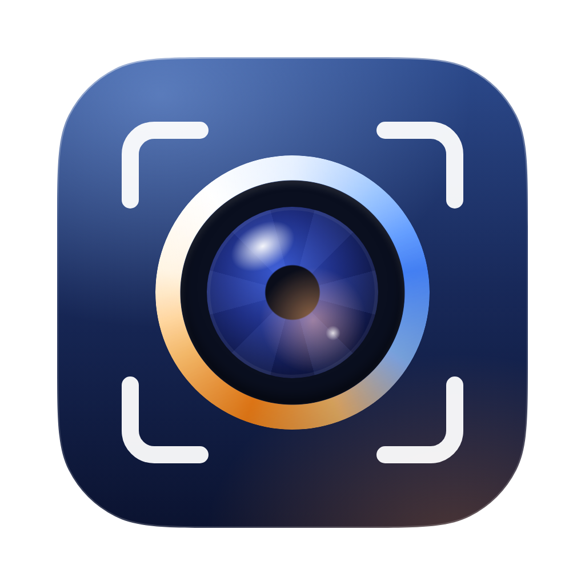

<p align="center"></p>

<h1 align="center">Framelight</h1>

<p align="center"><b>Every control your webcam has, plus a studio.</b><br>For macOS 26. Built for the Kreo Owl 4K Pro, works with any USB (UVC) webcam.</p>

macOS has no settings panel for USB webcams, so cameras like the Kreo Owl 4K Pro stay on whatever automatic settings they boot with. Framelight talks to the camera directly over USB (the UVC protocol) to unlock every control the hardware has. On top of that it adds a GPU studio pipeline: Center Stage-style auto framing, background blur, colour grading, and a virtual camera ("Framelight Camera") for Zoom, Meet, Teams and OBS.

## Features

### Camera tab: hardware controls (inside the camera)
These settings are applied by the camera itself, so **they work in every app**, including when you don't use Framelight's virtual camera.

| Group | Controls (only the ones your camera supports are shown) |
|---|---|
| Image | Brightness, Contrast (+ auto), Sharpness, Gamma |
| Color & White Balance | **Auto WB on/off, Color Temperature (K)**, WB red/blue gains, Saturation, Hue |
| Exposure & Light | **Exposure mode (manual / auto / priority), Exposure time**, Gain (ISO), Backlight compensation (WDR), Low-light frame-rate priority, Iris |
| Focus & Zoom | Auto focus on/off, Manual focus, Hardware zoom, In-camera digital zoom |
| Pan / Tilt / Roll | Hardware PTZ (on cameras that have it) |
| Advanced | **Anti-flicker 50/60 Hz** (use 50 Hz in India/Europe/Asia to stop LED banding), Privacy shutter |

* Live values: while a setting is on auto (for example auto white balance), the slider shows what the camera is choosing.
* **Settings survive replugging.** Most webcams forget their settings on power loss. Framelight re-applies them when the camera reconnects.
* Reset any control (or all of them) to the camera's factory default.

### Studio tab: natural processing (GPU, Core Image + Apple Vision)
Everything here is designed to look like a better camera, not like a filter.

* **Looks** are live thumbnails of your own image: Natural, Bright & Clean, Warm Room, Soft Film, Studio Crisp, Moody and Monochrome, each with a strength slider. They're all one grading model, not stacked effects:
  * Colour is processed in OKLab, a perceptual colour space, so contrast changes lightness only and saturation never shifts hue.
  * Highlights roll off like film instead of clipping, and colour fades gently near black and white.
  * Saturation is held back on skin, using the hue range where all skin tones sit (measured across the Monk Skin Tone scale).
  * Everything is baked into a single 3D LUT on the GPU.
* **Auto Light** meters your face. It only steps in when your face falls outside the normal 40–70% video-level band (IRE) for well-exposed skin, so darker and lighter skin both stay true.
* **Natural Skin Tones** uses the colourist's "skin tone line" to remove green or magenta casts from room lighting, gently and within limits, by adjusting white balance in linear light.
* **Noise reduction** is motion-adaptive and temporal: it averages frames only where nothing moves, so skin keeps its texture instead of turning plastic.
* **Background:**
  * Blur is halo-free: the person is cut out before blurring, the blur uses lens-shaped discs, and matching grain keeps it from looking pasted on.
  * Studio Light lifts you slightly and dims the room. There are also a softly lit colour backdrop and your own image.
  * The person matte follows real edges (Apple's edge-preserving upsample) and is smoothed over time so its edge doesn't shimmer.
* **Auto Framing (Center Stage-style)** builds the shot around your face and moves on critically damped springs, so it's smooth with no jitter.
* **Compare Before / After** shows a split preview, only in Framelight's own window.
* Exposure in EV, temperature in Kelvin, tint, contrast, saturation, vibrance, highlight recovery, shadow lift, sharpness and vignette.
* Mirror or upside-down, output 720p, 1080p, 1440p or 4K, a live histogram, PNG photos and H.264/HEVC recording.

The Camera tab also has a **Natural Baseline** button. It turns down the webcam's own over-sharpening and colour boosts, which software can't undo afterwards.

### Control & automation
* **Shots**: save four framings and recall them with ⌘1–⌘4. The view glides there like a camera operator would.
* **Gesture control**: hold up an open palm ✋ to toggle Auto Framing, or a peace sign ✌️ to toggle background blur.
* **Metering**: face, centre-weighted or average, with face-aware Auto Light.
* **Pick White Point**: click something white in the preview.
* **Creative LUTs**: import `.cube` files and blend them in on top of a look.
* **Name tag** lower third and one-click **Privacy** blur (⌘⇧H).
* **Output shapes**: 16:9, 4:3, 1:1 and vertical 9:16.
* **Automations**: apply a preset when an app comes to the front, and **Hold Camera Settings** when Zoom or Teams changes them.
* **Performance readout** in the Info tab, plus a headless benchmark: `Framelight.app/Contents/MacOS/Framelight --benchmark`.

See [docs/COMPETITIVE_AUDIT.md](docs/COMPETITIVE_AUDIT.md) for how this compares with Camo, Elgato Camera Hub, Opal, Insta360, OBSBOT, NVIDIA Broadcast and the UVC utilities.

### Presets
Save all hardware and studio settings under a name, apply them in one click, and import or export them as JSON. Starter looks are included.

### Virtual camera
"Framelight Camera" appears in Zoom, Google Meet, Teams, OBS, FaceTime and other apps, carrying everything from the Studio tab. Built with a Core Media I/O camera extension.

### Menu bar
Framelight keeps running in the menu bar when you close the window, with quick toggles for framing, blur, mirror, presets and the virtual camera.

## Requirements
* **macOS 26 or later**, on Apple Silicon or Intel (it uses the macOS 26 Liquid Glass interface)
* To build it yourself: Xcode 26 or later
* A UVC webcam (virtually all USB webcams, including the Kreo Owl 4K Pro)

## Install

### Option A: download the build from CI (no Xcode needed)
1. Open the repository's **Actions** tab → latest **Build** run → download **Framelight-app**.
2. Unzip it and move `Framelight.app` to `/Applications`.
3. The build isn't notarized, so clear the quarantine flag once:
   ```bash
   xattr -dr com.apple.quarantine /Applications/Framelight.app
   ```
4. Open it and allow camera access.

This build includes everything except the virtual camera (see Option C).

### Option B: build it yourself with SwiftPM
Needs Xcode 26 or the matching Command Line Tools.
```bash
./scripts/build-app.sh
```
```bash
open dist/Framelight.app
```

### Option C: full build with the virtual camera (Xcode)
macOS only loads camera extensions signed by a registered developer, so you need an **Apple Developer Program** membership.
```bash
brew install xcodegen
```
```bash
xcodegen generate && open Framelight.xcodeproj
```
1. In `project.yml` (or Xcode → Signing & Capabilities for both targets), set your `DEVELOPMENT_TEAM`. You can also change `APP_BUNDLE_ID`.
2. Build the **Framelight** scheme, then copy the built `Framelight.app` to **/Applications**. System extensions only activate from there.
3. In Framelight go to **Studio → Virtual Camera → Install Virtual Camera**, then approve it in System Settings → General → Login Items & Extensions → Camera Extensions (or Privacy & Security).
4. Turn on **Send to Virtual Camera** and choose "Framelight Camera" in your meeting app.

## Tips for the Kreo Owl 4K Pro
* Choose the **3840×2160 MJPEG** format in the toolbar. It gives auto framing the most pixels to crop from.
* Set **Anti-Flicker to 50 Hz** if you're in India (60 Hz in the Americas).
* For stable skin tones on stream, turn **Auto White Balance off** and set the colour temperature manually (about 4000–4500 K under warm room lights, 5500–6500 K in daylight).
* If the image is too dark at night, raise **Gain** or use the **Low-Light Rescue** look before slowing the shutter. A longer exposure causes motion blur.
* If a control seems missing, use **Info → Probe All Controls**. Some cameras under-report what they support.

## How it works
```
USB webcam ──UVC control requests (IOKit)──▶ hardware settings (Camera tab)
    │
    └─ video (AVFoundation) ─▶ Vision (faces / bodies / person mask)
                              ─▶ Core Image on the GPU: background → framing crop → colour → look
                              ─▶ preview (Metal) · recorder · virtual-camera sink ─▶ CMIO extension ─▶ Zoom/Meet/OBS
```

| Path | What |
|---|---|
| `Sources/Framelight/UVC/` | USB descriptor parsing, UVC control catalogue, IOKit control transfers, control store |
| `Sources/Framelight/Capture/` | AVCaptureSession, device and format selection |
| `Sources/Framelight/Processing/` | Frame processor, auto framer, Vision analyzer |
| `Sources/Framelight/Output/` | Recorder, virtual camera sink, system-extension installer |
| `Sources/Framelight/UI/` | SwiftUI interface |
| `CameraExtension/` | Core Media I/O camera extension (virtual camera) |
| `Tests/ParserCheck/` | Stand-alone checks for descriptor parsing and value encoding |
| `Tests/FramingCheck/` | Auto framing simulation: zoom, follow, hold still, smoothness |
| `Tests/ColorCheck/` | Colour engine checks: neutral greys, hue preservation, skin protection, auto light |
| `Design/AppIcon/` | App icon source (HTML/CSS, rendered to `Resources/AppIcon.icns`) |

## Troubleshooting
* **"No hardware controls found"**: the camera must be plugged in directly or through a data-capable hub. Built-in FaceTime and Continuity cameras don't support UVC controls, but the Studio tab still works with them.
* **A control is greyed out with an AUTO badge**: turn off its auto mode first (for example *Auto White Balance* before *Color Temperature*, or *Exposure Mode → Manual* before *Exposure Time*).
* **The virtual camera shows "Open the Framelight app"**: Framelight has to be running with *Send to Virtual Camera* on.
